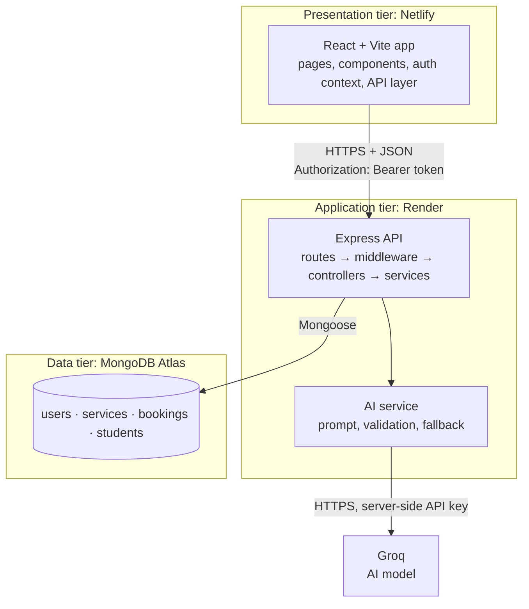
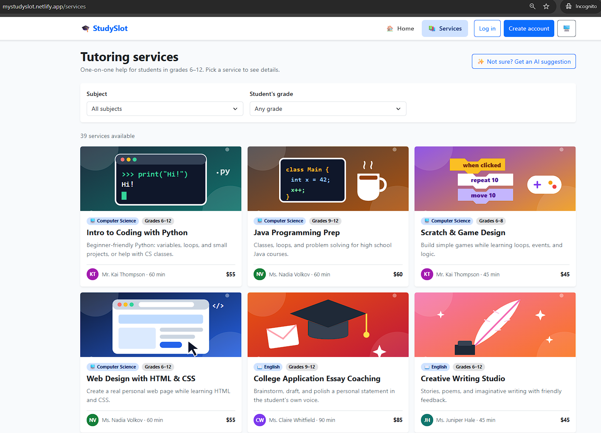
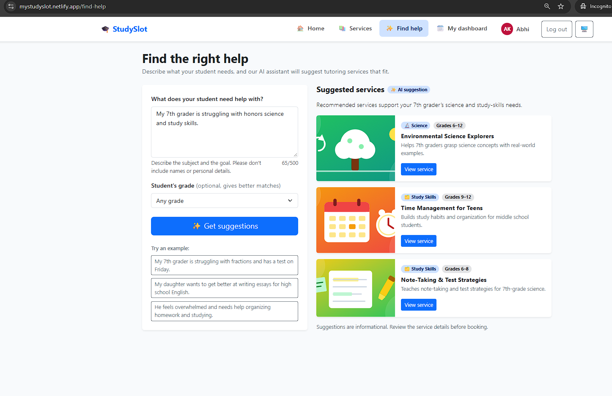
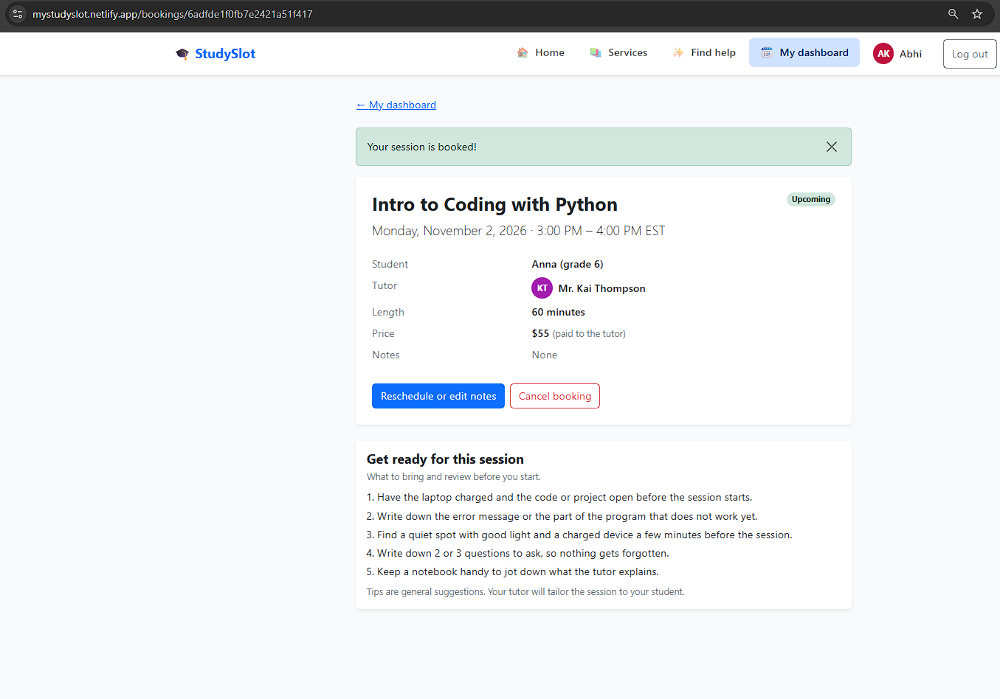
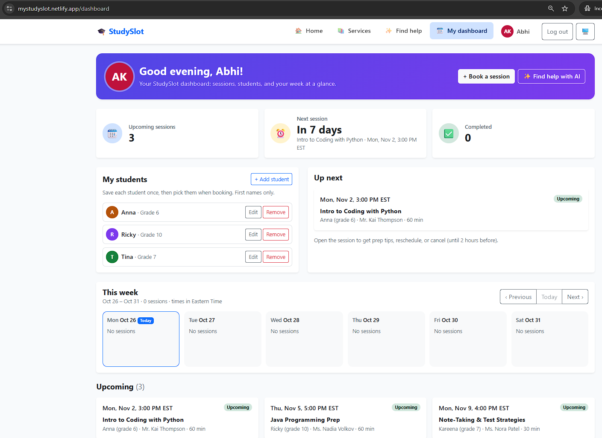
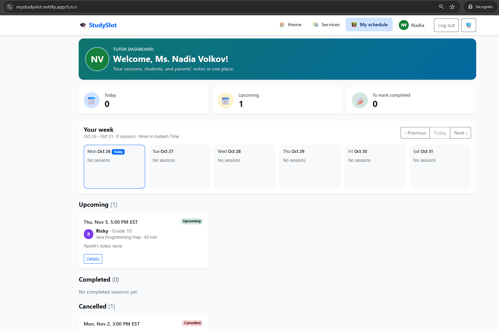

# StudySlot

An AI-assisted tutoring booking platform for students in grades 6–12. Parents browse tutoring services, get an AI suggestion for which service fits their student, and book and manage sessions. Tutors have their own accounts to see and complete their sessions.

**Bootcamp capstone project** · Author: Abhi Kuril

## Live links

| | URL |
|---|---|
| Live app (Netlify) | https://mystudyslot.netlify.app |
| API (Render) | https://studyslot-attl.onrender.com |
| Health check | https://studyslot-attl.onrender.com/api/health |
| Repository | https://github.com/akuril/studyslot |

The API runs on a free Render plan, which sleeps after 15 minutes without traffic. The first request after a sleep can take about a minute.

## Overview and problem statement

Parents of middle and high school students often have to phone or email several tutors to find one with the right subject, grade level, and open time, and it is easy to double-book or lose track of sessions. StudySlot puts the service catalog, availability rules, and bookings in one place, and an AI helper that turns "my 7th grader needs help with fractions" into a short list of matching services.

## Target users

- **Parents and guardians** (the account holder) who book sessions for a student. Only the student's first name and grade are stored.
- **Tutors** who sign in to see their sessions and mark them completed with a summary. Tutor accounts are created by a seed script, not by sign-up.
- There is no administrator role. The service catalog is managed by a seed script.

## Key features

- Browse and filter 39 active tutoring services by subject and grade
- Register, log in, and stay logged in across refreshes (JWT)
- Book, reschedule, edit notes on, and cancel sessions. Bookings follow Eastern Time hours (Mon–Fri 3–8 PM, Sat 9 AM–3 PM), 2 hours' notice, and no double-booking of a tutor
- Parent dashboard with next session, stats, and a week view
- Saved students (up to 10) for faster booking
- "Book again" on past and cancelled sessions: same service and student, new date and time
- Account page for parents and tutors: edit name (tutors: and bio), change password, personal numbers, and a tutor's linked services
- Tutor dashboard with session completion and a summary the parent can read
- "Find the right help": AI service recommendations
- Built-in prep tips for each upcoming session
- Light, dark, and automatic themes; responsive layout

## AI-powered feature and its limits

**Find the right help** (`POST /api/ai/recommend-service`) sends the parent's description, the student's grade, and the public service catalog to an AI model (Groq, `openai/gpt-oss-20b`). The model must answer in a fixed JSON format with up to three service ids and a short reason for each.

How it stays grounded and safe:
- The server only accepts service ids that exist in the catalog it sent, and adds names and grades from its own database, never from the model.
- The description is fenced as data, so instructions inside it are ignored.
- If the description clearly names a subject, picks from unrelated subjects are dropped.
- No names, emails, ids, or bookings are sent, and nothing is stored or logged.
- Login is required, with limits of 5 per minute and 20 per day per user.
- If the AI is not configured, is down, is slow, or answers badly, a keyword matcher gives a basic result and the response says so.

Limits: the model can still pick a weak match, results are not measured at scale, and the free provider has daily quotas. Suggestions are informational; the parent always chooses and books.

## Architecture



The browser never talks to the database or the AI provider. The server checks every request again, whatever the browser already checked. See `docs/architecture.md` for request flows.

## Technology stack

| Tier | Technology |
|---|---|
| Frontend | React 19, Vite, React Router, Bootstrap 5 (JavaScript) |
| Backend | Node.js 22+, Express 5, Mongoose, bcryptjs, jsonwebtoken, helmet, cors, express-rate-limit |
| Database | MongoDB Atlas |
| AI | Groq (OpenAI-compatible API) with a keyword fallback |
| Tests | Node's built-in test runner (server), Vitest (client), Postman |
| Hosting | Netlify (frontend), Render (backend), Atlas (database) |

## Folder structure

```
studyslot/
├── client/                  React app
│   ├── public/              _headers (security headers), theme-init.js
│   └── src/
│       ├── api/             fetch wrapper and one file per resource
│       ├── components/      reusable UI pieces
│       ├── context/         authentication state
│       ├── pages/           one file per screen
│       └── utils/           booking time rules, validation, roles (unit tested)
├── server/                  Express API
│   ├── scripts/             seed services/tutors, cleanup, AI checks
│   ├── src/
│   │   ├── config/          environment and database connection
│   │   ├── controllers/     read the request, call services, send the response
│   │   ├── middleware/      authentication, roles, rate limits, errors
│   │   ├── models/          Mongoose schemas
│   │   ├── routes/          URL to controller mapping
│   │   └── services/        booking rules, AI, fallback, prep tips
│   ├── tests/               automated tests
│   └── postman/             Postman collection and environment
├── docs/                    requirements, contracts, test plan, security review, deployment guide
└── netlify.toml             Netlify build settings
```

## Prerequisites

- Node.js 22.9 or newer (developed on Node 24)
- A MongoDB Atlas cluster and a database user (a free M0 cluster is enough)
- Optional: a Groq API key for the AI feature (without it the keyword fallback is used)

## Install and run locally

```bash
git clone https://github.com/akuril/studyslot.git
cd studyslot

# Backend
cd server
npm install
cp .env.example .env        # then fill in the values (see below)
npm run seed                # load the service catalog
npm run seed:tutors         # create the demo tutor accounts (needs TUTOR_SEED_PASSWORD)
npm run dev                 # API on http://localhost:5000

# Frontend (second terminal)
cd client
npm install
cp .env.example .env        # keeps VITE_API_BASE_URL=/api for local development
npm run dev                 # app on http://localhost:5173
```

On Windows PowerShell use `Copy-Item .env.example .env` instead of `cp`.

In development the Vite dev server forwards `/api` to the Express API, so the browser makes same-origin requests and needs no CORS.

### Environment variables

Names only. Never commit real values. The `.env` files are ignored by Git.

| File | Variable | Purpose |
|---|---|---|
| `server/.env` | `PORT` | Local API port (Render sets its own) |
| | `NODE_ENV` | `development`, `production`, or `test` |
| | `MONGODB_URI` | Atlas connection string, with the database name |
| | `JWT_SECRET` | Token signing secret, at least 32 random characters |
| | `JWT_EXPIRES_IN` | Login lifetime, for example `1d` |
| | `CLIENT_ORIGIN` | Exact origin of the React app, allowed by CORS |
| | `AI_PROVIDER`, `AI_MODEL`, `AI_API_KEY` | Optional AI settings |
| | `TUTOR_SEED_PASSWORD` | Used only by `npm run seed:tutors` |
| `client/.env` | `VITE_API_BASE_URL` | API address including `/api` (public, never a secret) |

### Demo accounts

Parents register through the app. Tutor logins are created by `npm run seed:tutors` from each tutor's name (for example `avery.lane@tutors.studyslot`) with the password you set in `TUTOR_SEED_PASSWORD`. These are fictional demo tutors.

## Testing

```bash
cd server && npm test        # 201 automated tests, no database or internet needed
cd client && npm test        # 73 unit tests for the client logic
cd client && npm run lint
```

Also: the Postman collection in `server/postman/`, the manual checklist in `docs/e2e-local-checklist.md`, and the full plan with results in `docs/test-plan.md`.

## API summary

All paths start with `/api`. Full details are in `docs/api-contract.md`.

| Method | Path | Who |
|---|---|---|
| GET | `/health` | Anyone |
| POST | `/auth/register`, `/auth/login` | Anyone (rate-limited) |
| GET | `/auth/me` | Logged in |
| PATCH | `/auth/me` | Logged in (name; tutors also bio) |
| POST | `/auth/change-password` | Logged in (failed attempts rate-limited) |
| GET | `/auth/me/summary` | Logged in (counts for the account page) |
| GET | `/services`, `/services/:id` | Anyone |
| POST | `/bookings` | Parent |
| GET | `/bookings/mine`, `/bookings/:id` | Owner |
| PATCH | `/bookings/:id` | Owner (reschedule or notes) |
| POST | `/bookings/:id/cancel` | Owner |
| POST | `/ai/recommend-service` | Logged in (rate-limited) |
| POST | `/ai/session-prep` | The booking's parent or tutor |
| GET, POST, PATCH, DELETE | `/students`, `/students/:id` | Parent (own students) |
| GET | `/tutor/sessions` | Tutor |
| POST | `/tutor/sessions/:id/complete` | The session's tutor |

## Deployment overview

Frontend on Netlify (base directory `client`, build `npm run build`, publish `dist`, settings in `netlify.toml`). Backend on Render (root directory `server`, build `npm install`, start `npm start`, health check `/api/health`). Database on MongoDB Atlas. Step-by-step instructions, environment variables, and the smoke test are in `docs/deployment-guide.md`.

## Screenshots

| Screen | Image |
|---|---|
| Services list |  |
| Find the right help (AI) |  |
| Booking form |  |
| Parent dashboard |  |
| Tutor dashboard |  |

## Known limitations

- The login token is stored in the browser's `localStorage`. A strict content security policy and React's escaping reduce the risk; httpOnly cookies would need extra CSRF protection.
- Logging out removes the token in the browser, but a copied token stays valid until it expires (1 day). Changing a password does not sign out other devices.
- Rate limits are kept in memory, so they reset when the server restarts and are not shared between servers.
- No payment processing, email or text reminders, or password reset. Prices are informational.
- All tutors share one demo password set by the seed script. Use fictional tutors only.
- The free Render plan sleeps when idle, and the free AI provider has daily quotas.
- The React pages are not covered by automated browser tests.

## Future improvements

- Password reset and email confirmations
- httpOnly cookie sessions with CSRF protection
- Tutor availability management and a tutor-managed catalog (admin role)
- Automated end-to-end browser tests
- Measuring recommendation quality on a set of sample requests
- Shared rate limiting (for example, Redis) for multiple servers

## Responsible AI usage

- AI is used for one thing: suggesting existing services. It never books, cancels, or changes anything.
- Only the description, the grade, and the public catalog are sent. No names, emails, or bookings. Nothing is stored or logged. The provider's zero-data-retention setting is turned on.
- Output is checked by the server before it is shown. Unknown services are dropped.
- The page tells parents not to enter personal details and that suggestions are informational.
- The app works without AI: a keyword fallback gives a clear, labeled result.
- AI also assisted development of this project (planning, code, tests, and documentation). Every change was reviewed, run, and tested by the author; the SDLC document gives examples.

## Documentation

`docs/user-stories.md` · `docs/architecture.md` · `docs/database-contract.md` · `docs/api-contract.md` · `docs/ai-feature-contract.md` · `docs/test-plan.md` · `docs/security-review.md` · `docs/deployment-guide.md` · `docs/e2e-local-checklist.md`

## History

StudySlot grew out of **HomeworkHQ**, a homework and test planner. The final HomeworkHQ version is preserved under the Git tag `homeworkhq-v1`.
