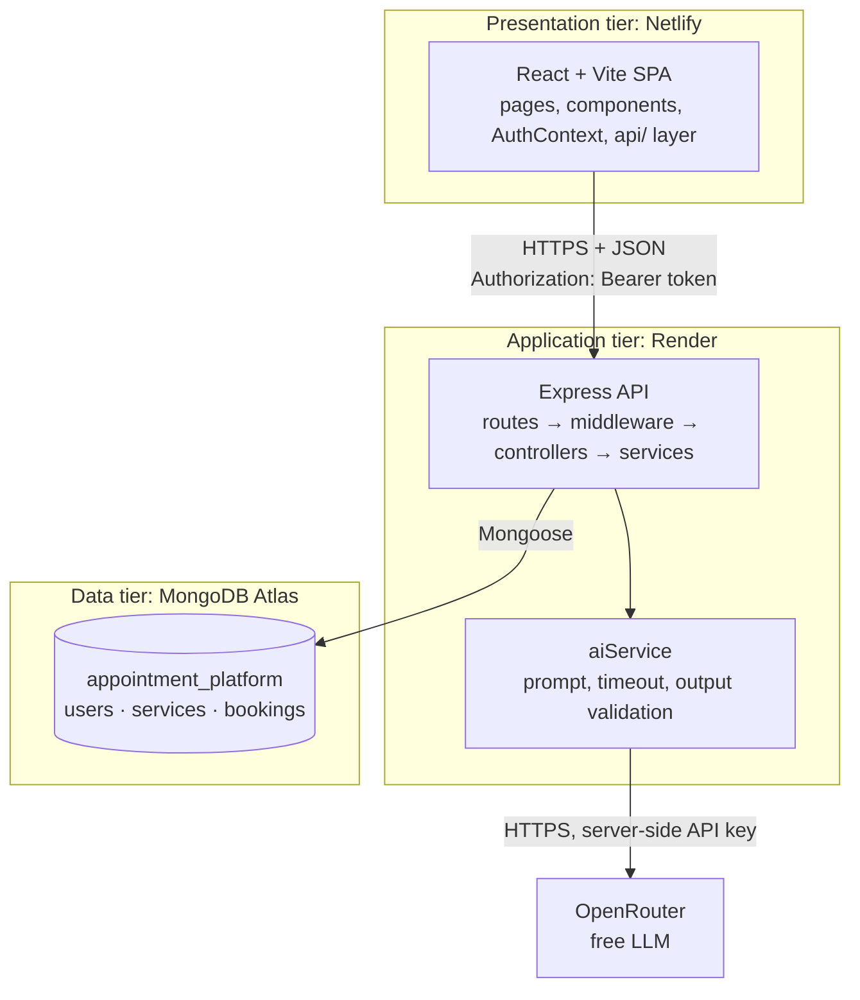
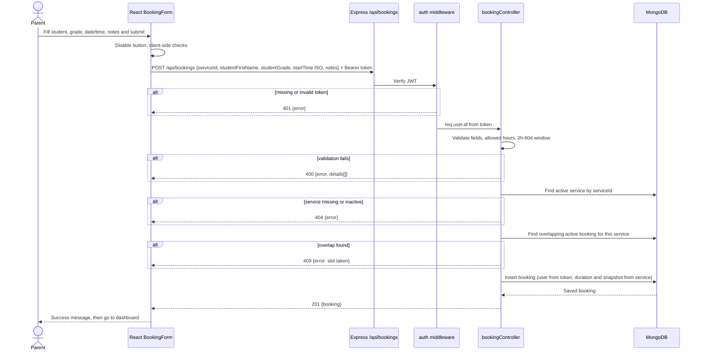

# StudySlot — Three-Tier Architecture and Data Flow

Approved: pending (Step 4)

## Overview



## Tier responsibilities

| Tier | Runs on | Responsible for | Never does |
|---|---|---|---|
| Presentation (React) | The user's browser, served by Netlify | Screens, routing, forms, client-side usability checks, loading/error/empty states, showing dates in local time, holding the auth token for the session | Talk to MongoDB or the AI provider; hold secrets; enforce security rules |
| Application (Express) | Render (Node server) | Validating and normalizing every request, authentication (JWT), authorization (ownership), business rules (hours, overlaps, cancellation window), rate limits, calling the AI provider, consistent error responses | Trust anything the browser sends (including user IDs); return password hashes, stack traces, or provider errors |
| Data (MongoDB) | Atlas cluster | Durable storage, schema validation, unique email, indexes for real queries | Get reached directly by the browser |

## Request flows

### Login
1. LoginPage sends `POST /api/auth/login` with `{ email, password }` through `api/auth.js`.
2. A rate limiter checks the request. A validator normalizes the email and checks the fields are present.
3. The controller finds the user by lowercase email, explicitly selecting the password hash, and compares the password with bcrypt.
4. Success returns **200** with `{ token, user: { id, name, email } }`. A wrong email or wrong password both return **401** with the same generic message.
5. AuthContext stores the token and user. Later requests send `Authorization: Bearer <token>`.

### Service browsing
1. ServicesPage requests `GET /api/services?subject=math`.
2. The controller allows only approved filters, queries `{ isActive: true, subject }`, and selects only public fields.
3. The response is **200** with an array of services. The page renders loading, then the list, or an empty state, or an error state.

### Booking creation
See the sequence diagram below.

### AI recommendation
1. FindHelpPage sends `POST /api/ai/recommend-service` with `{ need }`, which must be 500 characters or fewer, plus the token.
2. Auth middleware runs, then a per-user AI rate limiter, then input validation.
3. `aiService` loads active services (id, name, subject, grade band, short description only) and sends them with the user's text, labeled as **data, not instructions**, to OpenRouter with a timeout and a JSON-only output format.
4. The backend parses and validates the output and keeps only recommendations whose `serviceId` matches a real active service.
5. The response is **200** with `{ summary, recommendations[{ serviceId, name, reason }], disclaimer, source: "ai" | "fallback" }`.
6. On timeout, provider error, quota limit, or invalid output, the backend returns a keyword-match fallback with `source: "fallback"` and never forwards the raw provider error.

## Booking creation sequence



## Why the browser never talks to MongoDB or the AI provider directly

- **Anything shipped to the browser is public.** Vite bundles `VITE_*` variables into JavaScript that anyone can read in DevTools. A database URI or AI key there would let anyone read or delete all data, or spend the AI quota.
- **Security rules must run where users can't change them.** Ownership checks, booking hours, and overlap rules in React could be bypassed with Postman. Express is the gatekeeper.
- **The AI output must be verified.** Only the server can check that recommended service IDs really exist before showing them.
- **One contract.** The React app depends only on the REST API, so the database or AI provider can change without touching the UI.

## Origins

| Environment | Frontend origin | Backend base URL |
|---|---|---|
| Development | http://localhost:5173 | http://localhost:5000/api |
| Production | https://SITE-NAME.netlify.app (exact name chosen at deploy) | https://SERVICE-NAME.onrender.com/api |

- CORS allows **only** the exact frontend origin from `CLIENT_ORIGIN`. No wildcard.
- The frontend reads its API URL from `VITE_API_BASE_URL`. This is public configuration, not a secret.
- Render's free tier sleeps after 15 minutes idle (about a 1-minute wake-up). The UI shows a "waking up the server" message on slow first requests.

## Folder structure

```
studyslot/
├── client/                      React + Vite (Netlify)
│   ├── .env.example             VITE_API_BASE_URL
│   └── src/
│       ├── api/                 client.js (fetch wrapper) + auth, services, bookings, ai
│       ├── context/             AuthContext.jsx + AuthProvider.jsx
│       ├── components/          existing + ProtectedRoute, ServiceCard, BookingForm, BookingCard
│       ├── hooks/
│       ├── pages/               existing + new pages from user-stories.md
│       └── utils/
├── server/                      Express API (Render)
│   ├── .env.example
│   ├── package.json
│   ├── scripts/seedServices.js
│   └── src/
│       ├── config/              env.js, db.js
│       ├── models/              User, Service, Booking
│       ├── routes/              health, auth, services, bookings, ai
│       ├── controllers/         one per resource
│       ├── middleware/          auth, validate, rateLimits, notFound, errorHandler
│       ├── services/            aiService.js, bookingRules.js
│       ├── utils/               ApiError, helpers
│       ├── app.js               builds the Express app (no listen)
│       └── server.js            connects to DB, then listens
└── docs/
```

## Current client files that will change during integration

| File | Change |
|---|---|
| src/App.jsx | Add routes, AuthProvider, ProtectedRoute wrappers |
| src/components/Navbar.jsx | Services, Find help, My Bookings links; Log in/Register or name + Log out |
| src/components/RouteEffects.jsx | Page titles for the new routes |
| src/pages/HomePage.jsx | Replace the "being built" notice with calls to action |
| src/index.css | Small additions for new cards and forms |
| src/utils/dates.js | Date-and-time helpers for booking times |
