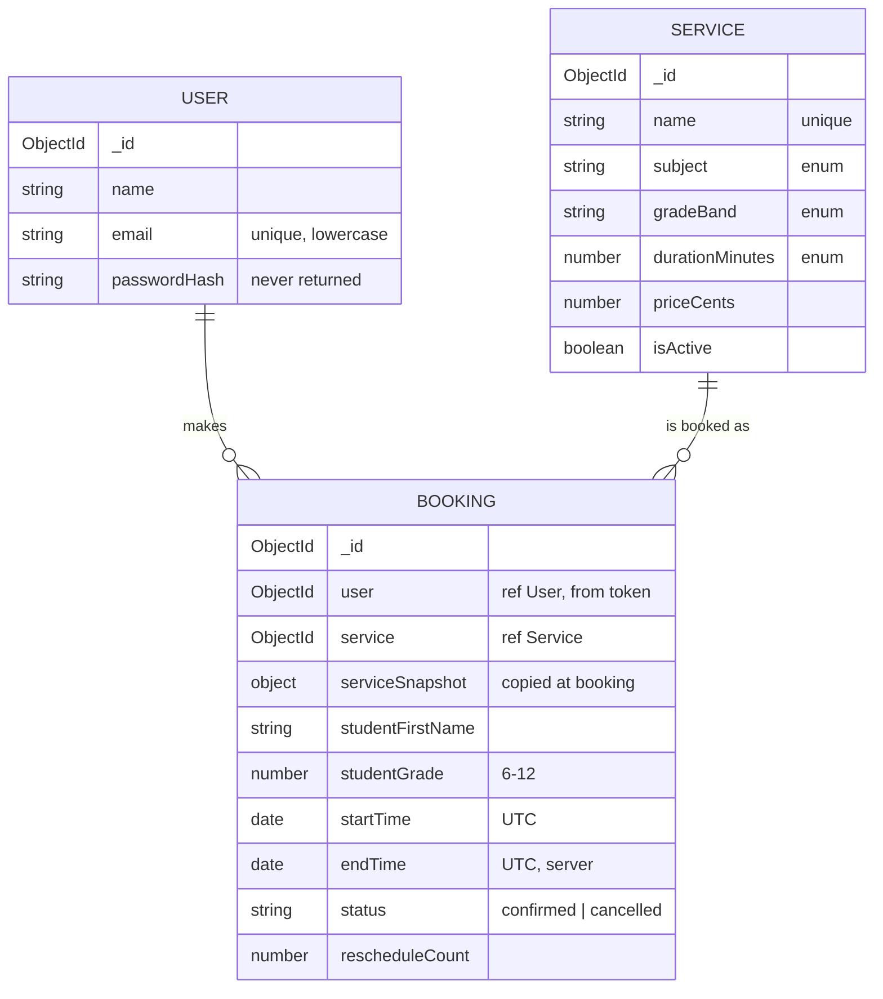

# StudySlot — Database Contract

Database: `appointment_platform` (MongoDB Atlas) · Collections: `users`, `services`, `bookings`

## users

| Field | Type | Required | Default | Rules | In API responses |
|---|---|---|---|---|---|
| _id | ObjectId | auto | auto | none | yes, as `id` |
| name | String | yes | none | trimmed, 2–60 characters | yes |
| email | String | yes | none | trimmed, lowercase, valid email, ≤254 characters, **unique** | yes |
| passwordHash | String | yes | none | bcrypt hash; `select: false` | **never** |
| createdAt / updatedAt | Date | auto | auto | none | createdAt only |

The password rule (8+ characters, at least one letter and one number) is checked at the API before hashing.

## services

| Field | Type | Required | Default | Rules | In API responses |
|---|---|---|---|---|---|
| _id | ObjectId | auto | auto | none | yes, as `id` |
| name | String | yes | none | trimmed, 3–80 characters, **unique** | yes |
| subject | String | yes | none | enum: `math`, `science`, `english`, `test-prep`, `homework-help` | yes |
| gradeBand | String | yes | none | enum: `6-8`, `9-12`, `6-12` | yes |
| summary | String | yes | none | ≤160 characters | yes |
| description | String | yes | none | ≤1000 characters | yes (detail and list) |
| tutorName | String | yes | none | ≤60 characters, fictional | yes |
| durationMinutes | Number | yes | none | enum: 30, 45, 60, 90 | yes |
| priceCents | Number | yes | none | integer ≥ 0 | yes |
| isActive | Boolean | yes | true | none | no (only active services are returned) |
| createdAt / updatedAt | Date | auto | auto | none | no |

Indexes: `{ name: 1 }` unique (seed upsert) · `{ isActive: 1, subject: 1, gradeBand: 1 }` (catalog filter).

## bookings

| Field | Type | Required | Default | Rules | Set by | In API responses |
|---|---|---|---|---|---|---|
| _id | ObjectId | auto | auto | none | none | yes, as `id` |
| user | ObjectId → users | yes | none | none | **server (token)** | no (always the requester) |
| service | ObjectId → services | yes | none | active at booking time | client `serviceId` | yes, as `serviceId` |
| serviceSnapshot.name | String | yes | none | none | **server** | yes |
| serviceSnapshot.tutorName | String | yes | none | none | **server** | yes |
| serviceSnapshot.durationMinutes | Number | yes | none | none | **server** | yes |
| serviceSnapshot.priceCents | Number | yes | none | none | **server** | yes |
| studentFirstName | String | yes | none | trimmed, 1–40 characters; letters, spaces, `-` and `'` | client | yes |
| studentGrade | Number | yes | none | integer 6–12 | client | yes |
| startTime | Date | yes | none | UTC; see booking rules | client (ISO 8601) | yes |
| endTime | Date | yes | none | startTime + snapshot duration | **server** | yes |
| originalStartTime | Date | yes | = first startTime | never changes | **server** | yes |
| notes | String | no | "" | ≤300 characters | client | yes |
| status | String | yes | confirmed | enum: `confirmed`, `cancelled` | **server (cancel action only)** | yes |
| cancelledAt | Date | no | null | none | **server** | yes |
| rescheduleCount | Number | yes | 0 | integer ≥ 0 | **server** | yes |
| lastRescheduledAt | Date | no | null | none | **server** | yes |
| createdAt / updatedAt | Date | auto | auto | none | auto | yes |

Indexes: `{ user: 1, startTime: 1 }` (dashboard) · `{ service: 1, status: 1, startTime: 1 }` (overlap check).

### Booking rules (America/New_York)

- Mon–Fri 15:00–20:00 and Sat 09:00–15:00. The whole session must fit inside these hours.
- Start time on :00 or :30.
- At least 2 hours and at most 60 days in the future.
- No overlap with another `confirmed` booking for the same service.
- Reschedule and cancel are allowed only while status is `confirmed` and the start is more than 2 hours away.
- A reschedule changes only `startTime` (and therefore `endTime`). It increments `rescheduleCount` and sets `lastRescheduledAt`. The duration stays the snapshot duration.

### Display status (computed by the client, not stored)

| Stored | Condition | Shown as |
|---|---|---|
| confirmed | endTime in the future | Upcoming (plus a "Rescheduled" badge when rescheduleCount > 0) |
| confirmed | endTime in the past | Completed |
| cancelled | any | Cancelled |

## Validation behavior

1. **API boundary first.** Each route validates and normalizes its request: trim, lowercase email, type checks, enums, lengths, ObjectId format, booking rules. A failure returns **400** with `{ error, details: [{ field, message }] }`.
2. **Only allowed fields** are copied from `req.body`. Unknown fields (for example `user`, `status`, `serviceSnapshot`, `role`) are ignored and never passed to MongoDB.
3. **Mongoose schema rules** are the last line of defense, in case a code path forgets a check. They should never be the first error a user sees.
4. **Duplicate email:** a MongoDB 11000 error becomes **409** `{ error: "An account with this email already exists" }`.

## Response formatting

- `_id` is returned as `id`. `__v` is never returned.
- Dates are ISO 8601 strings in UTC (`2026-10-27T20:00:00.000Z`).
- `passwordHash` is never returned (`select: false`, plus removed by the response mapper).

## Seed data (services)

All tutors, names, and descriptions are fictional. No real people, schools, or contact details. Only services are seeded; users and bookings are created through the app during testing, using `@example.com` emails.

| # | name | subject | gradeBand | min | price | tutorName | active |
|---|---|---|---|---|---|---|---|
| 1 | Middle School Math Boost | math | 6-8 | 60 | $45 | Ms. Avery Lane | yes |
| 2 | Algebra & Geometry Coaching | math | 9-12 | 60 | $55 | Mr. Theo Grant | yes |
| 3 | Life & Earth Science Help | science | 6-8 | 45 | $40 | Ms. Rosa Mendel | yes |
| 4 | Biology & Chemistry Tutoring | science | 9-12 | 60 | $55 | Dr. Priya Nair | yes |
| 5 | Reading & Writing Workshop | english | 6-8 | 45 | $40 | Mr. Jonah Reed | yes |
| 6 | Essay Writing Coach | english | 9-12 | 60 | $50 | Ms. Claire Whitfield | yes |
| 7 | SAT & ACT Prep | test-prep | 9-12 | 90 | $75 | Mr. Marcus Bell | yes |
| 8 | Homework Help Hour | homework-help | 6-12 | 30 | $25 | Ms. Dana Okoro | yes |
| 9 | Summer Math Bridge | math | 6-8 | 60 | $45 | Ms. Avery Lane | **no** (proves inactive services are hidden and can't be booked) |

Each seed also has a `summary` (≤160 characters) and `description` (≤1000 characters), written when the seed script is built in Step 13.

## Mapping from retired HomeworkHQ mock data

| HomeworkHQ field | StudySlot field | Notes |
|---|---|---|
| class.name | service.name | |
| class.teacher | service.tutorName | |
| class.color | none | Color now comes from `subject` in the UI, not stored |
| class.id (string) | service._id (ObjectId) | |
| assignment.classId | booking.service | |
| assignment.dueDate ("YYYY-MM-DD") | booking.startTime (UTC Date) | Now a date **and** time |
| assignment.notes | booking.notes | Same 300-character limit |
| assignment.completed | computed "Completed" | From endTime < now |
| assignment.title / type / priority / subtasks / completedAt | none | Not carried over |
